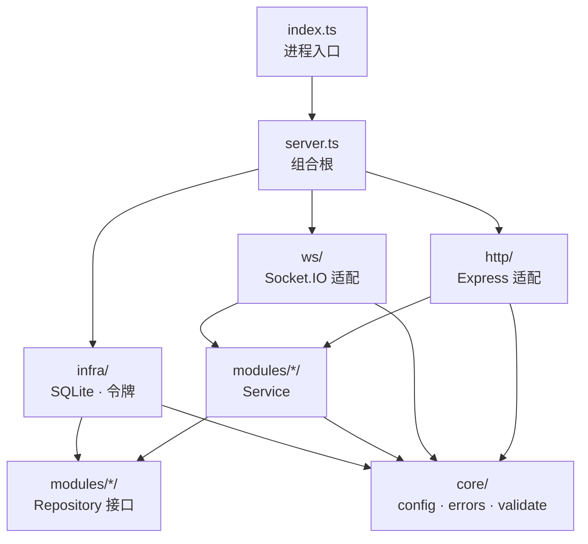

## 后端架构规范 · Express 5 + Socket.IO 4 + SQLite + Zod 4 + TypeScript

> 本文档是**可执行的规范**，不是散文。读者是 AI 编码代理与人类工程师：读完它应当能对任意一个
> Express + Socket.IO + SQLite 项目做无歧义的重构，且任何两个执行者对「这个文件放哪里」「这个错怎么返回」给出一致答案。
>
> 版本基线：Node 24 / Express 5.2 / Socket.IO 4.8 / Zod 4.6 / better-sqlite3 13 / pino 10 / TypeScript 5.7+。
> 文中的每条代码模板都已在 Node 24.12 + win32 上实跑通过（`tsc --noEmit` 无错，HTTP 与 WebSocket 两条通路端到端断言全绿），
> 验证方式见附录 C。

---

### 0. 如何使用本文档

#### 0.1 执行顺序

按顺序读，不要跳：

| 步骤 | 读哪一节      | 产出                                       |
| ---- | ------------- | ------------------------------------------ |
| 1    | §1 版本基线   | 确认依赖版本，升级不满足项                 |
| 2    | §2 目录结构   | 建立空目录骨架 + 目录职责边界              |
| 3    | §3 分层规则   | 建立依赖方向，把现有代码按层归类           |
| 4    | §4 逐条规范   | 逐条改造，每条都要能勾选                   |
| 5    | §5 反模式对照 | 遇到「以前这么写」的代码时，用此表决定去哪 |
| 6    | §6 迁移步骤   | 按顺序执行重构                             |
| 7    | §7 验收清单   | 全部勾选才算完成                           |

#### 0.2 冲突裁决

本文档与既有代码冲突时，按以下优先级裁决，**不要凭手感折中**：

1. 运行时正确性（进程会不会崩、错误会不会泄漏、并发下数据对不对）
2. 本文档的「必须」条目
3. 现存代码的既有约定
4. 个人偏好

发现本文档漏掉的情况时：**先按 §0.2 的 1、2 条原则选最保守的做法**，在 PR 描述里写明「规范未覆盖」。

#### 0.3 术语表（后文直接使用这些词）

| 术语                               | 定义                                                                                   |
| ---------------------------------- | -------------------------------------------------------------------------------------- |
| **模块（module）**                 | 一个业务能力（`user`/`order`/`chat`）。一个模块 = 一个目录 = 一个可独立删除/迁移的单元 |
| **入口层（entry point）**          | 把外部协议（HTTP/WS/定时任务）翻译成领域调用的适配器。薄，只做协议的翻译               |
| **领域层（service）**              | 业务规则与流程编排。不认识 HTTP 与 Socket                                              |
| **数据访问层（repository）**       | 唯一写 SQL 的地方。返回领域对象，不返回数据库行                                        |
| **边界（boundary）**               | 系统与不可信输入的接触点：请求体、查询串、路径参数、WS 载荷、环境变量、数据库返回行    |
| **信封（envelope）**               | 统一响应/回执外壳：HTTP 用 RFC 9457，WS 用 `{ ok, data                                 | error }` |
| **真源（single source of truth）** | 某条规则有且仅有一处定义。发现第二处即为缺陷                                           |

---

### 1. 版本基线

```jsonc
// package.json —— 以下为已实测可协同工作的组合
{
  "type": "module",
  "engines": { "node": ">=22" }, // Express 5 要求 ≥18；statement cache/错误 cause 等特性在 22+ 更完整
  "dependencies": {
    "express": "^5.2.1", // 5.x 关键：async handler 抛错自动进错误中间件
    "socket.io": "^4.8.4",
    "zod": "^4.6.5", // v4：错误格式化提升为顶层函数，JSON Schema 原生
    "better-sqlite3": "^13.0.3",
    "pino": "^10.4.0",
    "pino-http": "^11.0.0",
  },
  "devDependencies": {
    "typescript": "^5.7.0",
    "tsx": "^4.19.0",
    "@types/node": "^22.0.0",
    "@types/express": "^5.0.0",
    "@types/better-sqlite3": "^7.6.0",
    "vitest": "^3.0.0",
    "supertest": "^7.0.0",
    "socket.io-client": "^4.8.4",
  },
}
```

#### R1.1 用 Express 5，不要停留在 4

Express 5 对架构有实质影响，直接改变「错误处理中间件要不要包 async」这个决策：

- **async handler / 中间件返回的 rejected promise 会被自动转发到错误中间件**，无需 `express-async-errors` 之类的补丁。
  （[Express 5 迁移指南](https://expressjs.com/en/guide/migrating-5/)：「Rejected promises handled from middleware and handlers」）
- `req.query` 变成**只读 getter**，覆写会抛 `TypeError` 或静默失效 → 直接决定了 §4.2 的校验落点设计。
- `req.body` 在未挂 body parser 时是 `undefined`（Express 4 是 `{}`）。
- 路径语法变更：`/*` 必须写成 `/*splat`，`?` 可选段改为 `{}`，正则字符不再支持。
- `res.status()` 只接受 100–999 的整数，传非法值直接抛错。

仍停留在 Express 4 的项目：先升级，再按本文档重构。理由：4 需要为每个 async handler 手工 `try/catch(next)`，这个手工步骤

是错误处理出现分叉的头号来源。

#### R1.2 TypeScript 配置（最小可用集）

```jsonc
// tsconfig.json
{
  "compilerOptions": {
    "target": "ES2023",
    "lib": ["ES2023"],
    "module": "nodenext",
    "moduleResolution": "nodenext",
    "types": ["node"],
    "strict": true,
    "noUncheckedIndexedAccess": true, // 数组/Map 取值返回 T | undefined，逼出空值判断
    "noImplicitOverride": true,
    "verbatimModuleSyntax": true, // 强制 import type，避免运行时副作用导入
    "isolatedModules": true,
    "skipLibCheck": true,
    "noEmit": true,
    "allowImportingTsExtensions": true, // 允许源码里 import './x.ts'（配合 tsx 运行）
    "rewriteRelativeImportExtensions": true,
  },
  "include": ["src/**/*.ts", "tests/**/*.ts"],
}
```

`strict: true` 是**不可协商项**：Zod 的类型推导、`unknown` 的强制收窄、`res.locals` 的精确类型全部依赖它。

关掉严格模式等于放弃本文档一半的收益。

---

### 2. 目录结构

#### 2.1 权威结构

```txt
项目根/
├── ARCHITECTURE.md              ← 本文档，放在根目录便于 AI 代理与新人第一时间读到
├── package.json
├── tsconfig.json
├── .env                         ← 永不提交
├── .env.example                 ← 必须提交，列出全部键与占位值
├── migrations/                  ← 若选择「SQL 文件」式迁移（见 §4.5）；内联数组方案省略此目录
├── src/
│   ├── index.ts                 ← 进程入口：只做启动与进程级兜底
│   ├── server.ts                ← 组合根：装配依赖、创建 http.Server + Socket.IO
│   ├── core/                    ← 跨模块共享的「机制」，无业务语义
│   │   ├── config.ts            ← 环境变量的唯一入口与唯一校验点
│   │   ├── errors.ts            ← 统一错误模型（AppError 层级 + 错误码）
│   │   └── validate.ts          ← HTTP 边界校验中间件
│   ├── infra/                   ← 与外部世界的技术适配（可整体替换）
│   │   ├── sqlite/
│   │   │   ├── connection.ts    ← 连接工厂 + PRAGMA + 迁移
│   │   │   └── statement-cache.ts
│   │   └── auth/
│   │       └── token.ts         ← 令牌校验（HTTP 与 WS 共用）
│   ├── modules/                 ← 按业务能力纵切，每个模块自包含
│   │   └── user/
│   │       ├── user.model.ts       ← 领域对象 + 行结构 + 行→领域映射
│   │       ├── user.schema.ts      ← API 契约（Zod）：入参、出参
│   │       ├── user.repository.ts  ← 接口 + SQLite 实现
│   │       ├── user.service.ts     ← 业务规则
│   │       ├── user.dto-mapper.ts  ← 领域对象 → DTO（HTTP/WS 共用）
│   │       ├── user.routes.ts      ← HTTP 路由与处理器
│   │       └── user.gateway.ts     ← WS 事件注册（可选，无实时能力的模块不需要）
│   ├── http/                    ← HTTP 入口适配
│   │   ├── app.ts               ← Express app 装配
│   │   ├── error-handler.ts     ← 统一错误出口
│   │   └── middlewares/
│   │       └── request-id.ts
│   ├── ws/                      ← WS 入口适配
│   │   ├── contracts.ts         ← 前后端共享的事件类型（唯一真源）
│   │   ├── auth.ts              ← io.use 鉴权中间件
│   │   ├── handler-kit.ts       ← 事件处理器包装器（校验 + 错误收口 + ack 信封）
│   │   └── gateway.ts           ← 跨模块的 WS 装配
│   └── types/
│       └── express.d.ts         ← 全局类型增强（只放应用级字段）
└── tests/
    ├── smoke.ts                 ← 端到端冒烟（HTTP + WS 两条通路）
    └── modules/user/…           ← 模块级测试
```

#### 2.2 三条硬规则

**R2.2a 按业务能力纵切，禁止按技术角色横切。**

```text
✅ 允许                                   ❌ 禁止
modules/user/{model,schema,service,...}   controllers/user-controller.ts
modules/order/{...}                       services/user-service.ts
                                          models/user-model.ts
                                          repositories/user-repository.ts
```

理由：横切结构下，「给订单加一个字段」要同时改 4 个顶层目录、跨 4 次目录跳转、并且没有任何东西告诉你

哪些文件属于同一功能。纵切结构下，一个功能 = 一个目录，删除功能 = 删除目录，新人上手只需读一个目录。

出处：[goldbergyoni/nodebestpractices · Structure your solution by components](https://github.com/goldbergyoni/nodebestpractices/blob/master/sections/projectstructre/breakintcomponents.md)

（该节直接给出 Good/Bad 两种目录对照，Bad 正是上面的横切结构）；同仓库

[Layer your app](https://github.com/goldbergyoni/nodebestpractices/blob/master/sections/projectstructre/createlayers.md) 给出

每个组件内部再分 `entry-points / domain / data-access` 三层。

**R2.2b 顶层目录只有 `core / infra / modules / http / ws / types` 这几种角色，不得新增「按技术分类」的顶层目录。**

需要新的横切能力（缓存、队列、邮件）时：技术实现在 `infra/<技术名>/`，业务用法在对应 `modules/<feature>/`。

**R2.2c `modules/` 下的目录之间禁止互相 import 内部实现。**

跨模块协作只允许两种方式：① 依赖对方的 **Service 接口**（由组合根注入）；② 通过事件解耦。

禁止直接 import 对方模块的 `repository` / `model`。

---

### 3. 分层规则

#### 3.1 依赖方向



**R3.1 依赖必须单向。** 违反此图即为架构缺陷，无论代码能不能跑：

| 层                        | 允许 import                                    | 禁止 import                                                  |
| ------------------------- | ---------------------------------------------- | ------------------------------------------------------------ |
| `core/`                   | 仅 Node 内置 + zod + pino 类型                 | 任何 `modules/` `http/` `ws/` `infra/`                       |
| `infra/`                  | `core/` + 驱动库（better-sqlite3 等）          | `http/` `ws/`，`modules/*/service.ts`                        |
| `modules/*/service.ts`    | `core/`、本模块的 model/schema/repository 接口 | **`express`、`socket.io`、`better-sqlite3`**、其它模块的实现 |
| `modules/*/repository.ts` | `core/`、本模块 model、`infra/sqlite`          | `express`、`socket.io`                                       |
| `http/` `ws/`             | `core/`、`modules/*/service` 与 schema         | 直接 import `better-sqlite3` 或写 SQL                        |
| `server.ts`               | 一切（它是组合根）                             | ——                                                           |

**自动化检查**（放进 CI，比人工 review 可靠）。以下四条均已实测可用，跨 Windows/Linux；

`grep -vE '^[^:]*:[0-9]+:\s*(\*|//)'` 的作用是排除注释行，避免注释提到关键字就误报。

**每条都应当零输出（`exit=1`），否则即为架构违规**：

```bash
# 1) Service 层不得触碰 HTTP/WS/驱动
grep -rEn "from '(express|socket\.io|better-sqlite3)'" src/modules --include='*.service.ts' \
  | grep -vE '^[^:]*:[0-9]+:\s*(\*|//)'

# 2) SQL 只允许出现在 repository
grep -rEn "\b(SELECT|INSERT|UPDATE|DELETE FROM)\b" src --include='*.ts' \
  | grep -v 'repository\.ts' | grep -vE '^[^:]*:[0-9]+:\s*(\*|//)'

# 3) 配置只在 core/config.ts 读取
grep -rn "process\.env" src --include='*.ts' --exclude='config.ts' \
  | grep -vE '^[^:]*:[0-9]+:\s*(\*|//)'

# 4) 具体实现只在组合根 new
grep -rnE "new (Sqlite[A-Za-z]*Repository|[A-Z][A-Za-z]*Service)\(" src --include='*.ts' --exclude='server.ts' \
  | grep -vE '^[^:]*:[0-9]+:\s*(\*|//)'
```

> 把这四条包成一个 `pnpm run lint:arch` 脚本并接进 CI。人工 review 会漏，脚本不会。

#### 3.2 每一层做什么、不做什么

**入口层（`*.routes.ts` / `*.gateway.ts` / `http/app.ts`）**

职责：声明路由/事件与中间件链 → 取已校验输入 → 调 Service → 序列化响应。

代码量参考：每个处理函数 3–8 行。超过 15 行说明业务逻辑漏在了这里。

```ts
// ✅ 入口层该有的样子：无判断、无 SQL、无 try/catch
router.post('/', validate({ body: CreateUserBody }), createUser)
```

**领域层（`*.service.ts`）**

职责：业务规则、流程编排、事务边界的选择。

禁止：`req`/`res`/状态码、SQL、`process.env`、`socket` 对象、`console`。

```ts
// ✅ 领域层只认识「参数进、领域对象出」，因此 HTTP 与 WS 可复用同一段逻辑
create(input: { name: string; email: string }): User {
  if (this.users.findByEmail(input.email) !== undefined) throw new ConflictError('邮箱');
  return this.users.insert(input);
}
```

为什么必须这样分：把业务逻辑留在 controller 里，是后面所有维护成本的源头——测试要 mock `req`/`res`；

定时任务和 WebSocket 想复用时只能「服务端发 HTTP 请求给自己」；判断「该不该发响应」与「该不该继续算」纠缠在一起。

（[Bulletproof node.js architecture](https://softwareontheroad.com/ideal-nodejs-project-structure) 用一整个反例演示了这个失败模式，

并给出三条禁令：不要把代码留在 express router、不要把 `req`/`res` 传进 service、不要从 service 返回状态码/headers。）

**数据访问层（`*.repository.ts`）**

职责：SQL、行↔领域对象映射、持久化细节。

禁止：业务判断（「邮箱重复要返回 409」是业务规则，不是 SQL 的事；repository 只报告「唯一约束被违反」）。

**为什么不让 Service 直接用驱动**：契约会跟着数据库漂移。列名一改，API 响应就变了；`password_hash` 这类字段

会一路漂到客户端。中间隔一层显式映射，是让「数据库改名」与「接口改名」互不影响的唯一办法

（Fowler 的 [Repository](https://martinfowler.com/eaaCatalog/repository.html) / [Data Mapper](https://martinfowler.com/eaaCatalog/dataMapper.html) 模式）。

---

### 4. 逐条规范

#### 4.1 配置

**R4.1a 环境变量只在 `core/config.ts` 读取一次，其它任何文件出现 `process.env` 即为缺陷。**

```ts
// src/core/config.ts
import { z } from 'zod'

const EnvSchema = z.object({
  NODE_ENV: z.enum(['development', 'test', 'production']).default('development'),
  /** 0 = 由操作系统分配空闲端口（集成测试用） */
  PORT: z.coerce.number().int().min(0).max(65535).default(3000),
  DATABASE_FILE: z.string().min(1).default('./data/app.db'),
  LOG_LEVEL: z.enum(['silent', 'fatal', 'error', 'warn', 'info', 'debug', 'trace']).default('info'),
  JWT_SECRET: z.string().min(16).default('dev-only-insecure-secret-key'),
  CORS_ORIGINS: z.string().default('http://localhost:5173'),
})

export type AppConfig = Readonly<z.output<typeof EnvSchema>> & {
  readonly corsOrigins: readonly string[]
  readonly isProduction: boolean
}

export function loadConfig(env: NodeJS.ProcessEnv = process.env): AppConfig {
  const parsed = EnvSchema.safeParse(env)
  if (!parsed.success) {
    // 此时日志系统尚未初始化，用 console 输出完整细节是唯一选择
    throw new Error(`环境变量配置非法：\n${z.prettifyError(parsed.error)}`)
  }
  const value = parsed.data
  return Object.freeze({
    ...value,
    corsOrigins: Object.freeze(
      value.CORS_ORIGINS.split(',')
        .map((s) => s.trim())
        .filter(Boolean),
    ),
    isProduction: value.NODE_ENV === 'production',
  })
}
```

**为什么**：`process.env.X` 到处出现有三个后果——① 拼错变量名不会报错，只是 `undefined`；② 缺失的配置在

某个深夜才被触发的分支里才爆炸，而不是启动时；③ 测试无法构造配置，只能改全局环境。

把它们过一遍 Zod，就得到「启动即失败」+ 类型完备 + 可注入测试值三件事。

**R4.1b 生产环境必须显式提供所有密钥。** 上例的 `JWT_SECRET` 默认值只用于开发；在 `production` 下

应改为必填（去掉 `.default()`），让它成为启动阻塞项。

**R4.1c `.env` 永不提交，`.env.example` 必须提交。** 这是 [12-Factor App](https://12factor.net/config) 的配置原则：

配置属于环境，不属于代码。

#### 4.2 边界校验（HTTP）

**R4.2a 一份 Zod schema 同时是校验规则、TypeScript 类型、OpenAPI schema 的真源。禁止再手写重复的 `interface`。**

```ts
// src/modules/user/user.schema.ts
import { z } from 'zod'

export const CreateUserBody = z
  .strictObject({
    name: z.string().trim().min(1).max(64),
    email: z.email(), // Zod 4：格式校验提升为顶层函数，z.string().email() 已废弃
  })
  .meta({ id: 'CreateUserBody', description: '创建用户请求体' })

// 类型从 schema 推导，不手写
export type CreateUserBody = z.infer<typeof CreateUserBody>

export const UserIdParams = z.object({ id: z.coerce.number().int().positive() })
export const ListUsersQuery = z.object({
  page: z.coerce.number().int().min(1).default(1), // query 值恒为 string，数字必须 coerce
  pageSize: z.coerce.number().int().min(1).max(100).default(20),
})
export const UserDto = z.object({
  id: z.number(),
  name: z.string(),
  email: z.string(),
  createdAt: z.iso.datetime(),
})
```

**为什么**：手写 `interface CreateUserBody` + Zod schema 的组合是两份真源，必然漂移——有人改了校验规则忘了改类型，

或反过来。`z.infer` 让类型成为校验规则的**派生**，漂移在结构上不可能发生。

选择 `strictObject` 而不是 `object`：输入契约应当**拒绝**未声明的字段（拼错字段名会立刻 422），

而不是静默丢弃它们（客户端以为设置成功了，服务端当没看见）。

**R4.2b 校验结果写入 `res.locals.validated`，绝不覆写 `req.body` / `req.query` / `req.params`。**

```ts
// src/core/validate.ts
import type { NextFunction, Request, Response } from 'express'
import { z } from 'zod'
import { ValidationError } from './errors.ts'

export interface RequestSchemas {
  params?: z.ZodType
  query?: z.ZodType
  body?: z.ZodType
  headers?: z.ZodType
}

const VALIDATION_SOURCES = ['params', 'query', 'body', 'headers'] as const

/** 由 schema 推导校验后的数据类型，供路由标注 `res.locals` 的精确类型 */
export type Validated<Schemas extends RequestSchemas> = {
  [K in keyof Schemas as Schemas[K] extends z.ZodType ? K : never]: z.output<Schemas[K]>
}

export interface AppLocals<Schemas extends RequestSchemas = RequestSchemas> {
  validated: Validated<Schemas>
}

export function validate<const Schemas extends RequestSchemas>(schemas: Schemas) {
  // Express 5 中 async handler 的 rejection 会自动转发给错误中间件，因此这里不需要 try/catch
  return async (req: Request, res: Response, next: NextFunction): Promise<void> => {
    const settled: Record<string, unknown> = {}

    for (const source of VALIDATION_SOURCES) {
      const schema = schemas[source] as z.ZodType | undefined
      if (!schema) continue

      const result = await schema.safeParseAsync(req[source])
      if (!result.success) {
        // 不在这里写响应：错误响应体只允许有一个生产者（统一错误中间件）
        next(new ValidationError(source, z.flattenError(result.error), result.error))
        return
      }
      // 使用解析后的数据（已 strip 未知键 / coerce / trim），而不是原始输入
      settled[source] = result.data
    }

    res.locals.validated = settled
    next()
  }
}
```

**为什么不用 `req.body = parsed`**：

① Express 5 的 `req.query` 是只读 getter，覆写在严格模式下直接抛 `TypeError`，在非严格模式下静默失效——

是一个「本地能跑、线上随机失效」的陷阱；

② 覆写会让**原始载荷消失**，出问题时无法回答「客户端到底发了什么」；

③ `res.locals` 有泛型 `LocalsObj` 支持，可以精确到单条路由，而往 `req` 上挂业务字段只能做全局宽类型。

**R4.2c 路由处理函数用 `RequestHandler` 的五个泛型标注类型，第五个参数即 `res.locals`。**

```ts
// src/modules/user/user.routes.ts
import { Router, type RequestHandler } from 'express'
import { validate, type AppLocals } from '../../core/validate.ts'
import { CreateUserBody, ListUsersQuery, UserIdParams, type UserDto } from './user.schema.ts'
import { toUserDto } from './user.dto-mapper.ts'
import type { UserService } from './user.service.ts'

export function createUserRouter(users: UserService): Router {
  const router = Router()

  // 泛型顺序：<路径参数, 响应体, 请求体, 查询参数, res.locals>
  const createUser: RequestHandler<
    Record<string, never>,
    UserDto,
    unknown,
    unknown,
    AppLocals<{ body: typeof CreateUserBody }>
  > = (req, res) => {
    const { body } = res.locals.validated // body 的类型 = z.infer<typeof CreateUserBody>
    res.status(201).json(toUserDto(users.create(body)))
  }

  const listUsers: RequestHandler<
    Record<string, never>,
    { items: UserDto[]; total: number },
    unknown,
    unknown,
    AppLocals<{ query: typeof ListUsersQuery }>
  > = (req, res) => {
    const { query } = res.locals.validated
    const page = users.list(query.page, query.pageSize)
    res.json({ items: page.items.map(toUserDto), total: page.total })
  }

  router.post('/', validate({ body: CreateUserBody }), createUser)
  router.get('/', validate({ query: ListUsersQuery }), listUsers)
  return router
}
```

**R4.2d 校验失败一律返回 422 + 字段级明细，不返回 400。**

400 留给「请求格式本身就不对」（如 JSON 解析失败）；「JSON 格式正确但字段不合法」是 422。

把两者分开，客户端才能区分「我的请求发坏了」与「用户填错了」。Zod 4 的 `z.flattenError()` 产出

`{ formErrors, fieldErrors }`，它天然就是给前端表单用的形状。

**R4.2e 其它边界同样必须校验**：WS 载荷（见 §4.6）、环境变量（§4.1）。

数据库返回行由 §4.5 的映射层收敛，不额外跑 Zod。

#### 4.3 统一错误模型

**R4.3a 错误分三类，只有「可预期错误」允许把 message 暴露给客户端。**

| 类别           | 例子                                        | HTTP                        | message 能否出网                 | 日志级别 | 是否告警 |
| -------------- | ------------------------------------------- | --------------------------- | -------------------------------- | -------- | -------- |
| 可预期业务错误 | 参数非法、未认证、不存在、冲突、配额超限    | 400/401/403/404/409/422/429 | **能**（message 是契约的一部分） | `warn`   | 否       |
| 编程错误       | `TypeError`、不可能分支、未处理的 rejection | 500                         | **绝不**（只回 requestId）       | `error`  | 是       |
| 基础设施错误   | 数据库报错、上游超时                        | 500/502/503                 | 不暴露细节                       | `error`  | 是       |

出处：[OWASP Error Handling Cheat Sheet](https://cheatsheetseries.owasp.org/cheatsheets/Error_Handling_Cheat_Sheet.html)

（未预期错误只回通用响应、细节记到服务端日志）、[Node.js Errors 文档](https://nodejs.org/api/errors.html)

（错误分类；并明确 `error.message` 可能随版本变化，**判断错误必须用 `error.code`**）。

**R4.3b 用 `AppError` 类层级表达错误，`code` 是唯一对外契约。**

```ts
// src/core/errors.ts
/** 稳定错误码：客户端按 code 分支，message 只用于展示 */
export const ErrorCode = {
  VALIDATION_FAILED: 'VALIDATION_FAILED',
  UNAUTHENTICATED: 'UNAUTHENTICATED',
  FORBIDDEN: 'FORBIDDEN',
  NOT_FOUND: 'NOT_FOUND',
  CONFLICT: 'CONFLICT',
  INTERNAL: 'INTERNAL',
  STORAGE_UNAVAILABLE: 'STORAGE_UNAVAILABLE',
} as const
export type ErrorCode = (typeof ErrorCode)[keyof typeof ErrorCode]

export interface AppErrorOptions {
  message: string
  code: ErrorCode
  status: number
  /** 是否允许 message 出网；默认 true（业务错误） */
  expose?: boolean
  details?: unknown
  /** 原始错误，保留调用链 */
  cause?: unknown
}

export class AppError extends Error {
  readonly code: ErrorCode
  readonly status: number
  readonly expose: boolean
  readonly details?: unknown

  constructor(options: AppErrorOptions) {
    super(options.message, { cause: options.cause }) // ES2022 错误链
    this.name = new.target.name
    this.code = options.code
    this.status = options.status
    this.expose = options.expose ?? true
    this.details = options.details
    Error.captureStackTrace?.(this, new.target) // 去掉构造器自身的栈帧
  }

  /** 序列化为 RFC 9457 problem+json */
  toProblem(requestId: string): Record<string, unknown> {
    return {
      type: `https://errors.example.com/${this.code}`,
      title: this.expose ? this.message : '服务器内部错误',
      status: this.status,
      code: this.code,
      ...(this.expose && this.details !== undefined ? { errors: this.details } : {}),
      instance: requestId,
    }
  }
}

export class NotFoundError extends AppError {
  constructor(what: string) {
    super({ message: `${what} 不存在`, code: ErrorCode.NOT_FOUND, status: 404 })
  }
}
export class ConflictError extends AppError {
  constructor(what: string, cause?: unknown) {
    super({ message: `${what} 已存在`, code: ErrorCode.CONFLICT, status: 409, cause })
  }
}
export class ValidationError extends AppError {
  constructor(source: string, details: unknown, cause?: unknown) {
    super({
      message: `请求参数校验失败（${source}）`,
      code: ErrorCode.VALIDATION_FAILED,
      status: 422,
      details,
      cause,
    })
  }
}

/** 把任意 unknown 收敛成 AppError；未知错误一律 INTERNAL 且不外泄 message */
export function toAppError(err: unknown): AppError {
  if (err instanceof AppError) return err
  return new AppError({
    message: '服务器内部错误',
    code: ErrorCode.INTERNAL,
    status: 500,
    expose: false,
    cause: err,
  })
}
```

**为什么用类层级而不是裸 `Error` + 附加属性**：`instanceof` 是编译期与运行期都可靠的判别方式；

配合 `expose` 字段，边界层不需要维护一张「哪些错误码能暴露」的表——暴露性由错误自身的类型决定。

**`cause` 的坑**：它被设计成 **non-enumerable**（[MDN](https://developer.mozilla.org/en-US/docs/Web/JavaScript/Reference/Global_Objects/Error/cause)），

所以 `console.log(err)` 看不到它。日志必须用专门的序列化器展开（见 §4.4）。

**R4.3c 业务错误只抛不接。** Service 里 `throw new NotFoundError('用户')`；不写 `try/catch` 再转成状态码。

唯一允许 catch 的地方是「需要补偿/重试/降级」时，且必须 `throw` 或返回明确结果，不得吞掉。

**R4.3d 响应体用 RFC 9457，Content-Type 为 `application/problem+json`。**

```ts
// src/http/error-handler.ts
import type { ErrorRequestHandler, NextFunction, Request, Response } from 'express'
import type { Logger } from 'pino'
import { AppError, ErrorCode, toAppError } from '../core/errors.ts'

/** better-sqlite3 的错误码是 SQLITE_* 字符串；不要用 message 匹配（message 会随版本变化） */
function sqliteCodeOf(err: unknown): string | undefined {
  const code = (err as { code?: unknown } | null)?.code
  return typeof code === 'string' && code.startsWith('SQLITE_') ? code : undefined
}

export function createErrorHandler(logger: Logger): ErrorRequestHandler {
  // 必须 4 个参数：Express 靠函数 arity 识别错误中间件；少一个参数就会被当普通中间件
  return (err: unknown, req: Request, res: Response, next: NextFunction): void => {
    // 响应头已发出（如流式响应中途失败）：只能交回 Express 默认处理器，否则请求悬挂
    if (res.headersSent) {
      next(err)
      return
    }

    const requestId = req.requestId
    const sqliteCode = sqliteCodeOf(err)
    let appError: AppError

    if (err instanceof AppError) {
      appError = err
      logger.warn({ err, code: err.code, requestId }, '业务错误')
    } else if (sqliteCode !== undefined) {
      // 基础设施错误：唯一约束冲突是业务语义（409），其余视为存储不可用（503）
      const isConstraint =
        sqliteCode === 'SQLITE_CONSTRAINT_UNIQUE' || sqliteCode === 'SQLITE_CONSTRAINT_PRIMARYKEY'
      appError = isConstraint
        ? new AppError({ message: '资源已存在', code: ErrorCode.CONFLICT, status: 409, cause: err })
        : new AppError({
            message: '存储服务不可用',
            code: ErrorCode.STORAGE_UNAVAILABLE,
            status: 503,
            expose: false,
            cause: err,
          })
      logger.error({ err, sqliteCode, requestId }, '数据库错误')
    } else {
      appError = toAppError(err)
      logger.error({ err, requestId }, '未处理错误')
    }

    res.status(appError.status).type('application/problem+json').json(appError.toProblem(requestId))
  }
}
```

**为什么把 SQLite 错误码的翻译放在这里而不是 repository**：同一个「唯一约束冲突」在 HTTP 下是 409，

在 WS 下要变成 ack 信封里的 `CONFLICT`，在批处理里可能只是跳过该条。翻译是**表现层**的事，

repository 只如实报告「约束被违反」。放在一处，三个出口自然一致。

> RFC 9457 已取代 RFC 7807（前者在头部标注 `Obsoletes: RFC7807`）。新项目直接引用 9457。

#### 4.4 日志

**R4.4a 禁止 `console.log`。统一用 pino，请求内使用 `req.log`。**

```ts
// src/http/app.ts 片段
app.use(requestIdMiddleware) // 必须在 pino-http 之前
app.use(
  pinoHttp({
    logger,
    genReqId: (req) => {
      const assigned: unknown = Reflect.get(req, 'requestId')
      return typeof assigned === 'string' ? assigned : randomUUID()
    },
    customLogLevel: (_req, res, err) => {
      if (err !== undefined && err !== null) return 'error'
      if (res.statusCode >= 500) return 'error'
      if (res.statusCode >= 400) return 'warn'
      if (res.statusCode >= 300) return 'silent'
      return 'info'
    },
  }),
)
```

```ts
// src/server.ts 片段
pino({
  level: config.LOG_LEVEL,
  serializers: { err: pino.stdSerializers.errWithCause }, // 默认 err 序列化器不会展开 cause
  redact: { paths: ['req.headers.authorization', 'req.headers.cookie'], censor: '[REDACTED]' },
})
```

**为什么**：`console.log` 产出的是无结构文本——无法按 `requestId` 聚合一次请求的全部日志、

无法按级别过滤、无法被采集器解析、无法脱敏、无法运行时调级。pino 输出 NDJSON，这些能力全部具备。

**两个易踩的点**：

① pino 的默认 `err` 序列化器**只把 cause 的 message/stack 拼进 err.message**，不会展开 cause 字段；

要完整错误链必须换成 `pino.stdSerializers.errWithCause`。

② `redact` 是必需的，不是可选的：默认情况下 `req.headers.authorization` 会原样进日志。

**R4.4b 每个请求生成的 `requestId` 必须同时出现在：日志、响应头 `X-Request-Id`、错误响应体的 `instance` 字段。**

三者对齐，才能让「用户报障截图」→「日志检索」→「具体错误」三步内闭环。

#### 4.5 数据访问（SQLite）

**R4.5a 所有 SQL 只出现在 `*.repository.ts`。** 检查方式见 §3.1 的 grep。

**R4.5b 连接必须显式设置 PRAGMA，顺序不能乱。**

```ts
// src/infra/sqlite/connection.ts
import Database from 'better-sqlite3'

export interface OpenOptions {
  readonly?: boolean
  busyTimeoutMs?: number
  cacheKib?: number
  walSizeLimitBytes?: number
}

export function openDatabase(file: string, options: OpenOptions = {}): Database.Database {
  const busyTimeoutMs = options.busyTimeoutMs ?? 5_000
  const db = new Database(file, { readonly: options.readonly ?? false, timeout: busyTimeoutMs })

  // 1) WAL：读不再被写阻塞。要求所有访问者同主机，不能放网络文件系统。
  db.pragma('journal_mode = WAL')
  // 2) 必须紧跟 WAL 之后显式设置 —— 见下方说明
  db.pragma('synchronous = NORMAL')
  // 3) 外键约束
  db.pragma('foreign_keys = ON')
  // 4) 页缓存 16 MiB
  db.pragma(`cache_size = ${-(options.cacheKib ?? 16_000)}`)
  // 5) 等锁超时（注意：它是主线程 sleep，不能替代应用层退避）
  db.pragma(`busy_timeout = ${busyTimeoutMs}`)
  // 6) 避免 WAL 无界增长
  db.pragma('wal_autocheckpoint = 1000')
  db.pragma(`journal_size_limit = ${options.walSizeLimitBytes ?? 64 * 1024 * 1024}`)

  return db
}
```

**为什么 `synchronous = NORMAL` 必须写在 WAL 之后**：连接打开那一刻数据库文件的 `journal_mode` 决定

`synchronous` 的默认值。如果文件原本是 `delete` 模式，本次连接会锁定 `FULL`，**之后再切 WAL 也不会重新评估**——

也就是「首次从 delete 转 WAL 的那一次进程生命周期」会一直按 FULL 跑，每个事务多一次 WAL fsync。实测序列：

```txt
库原本 delete → 打开 → 同连接切 WAL → synchronous 仍为 2 (FULL)   ← 陷阱
库已是 WAL    → 打开 →               synchronous 为 1 (NORMAL)
库原本 delete → 打开 → 显式设 NORMAL → synchronous 为 1 (NORMAL)   ← 正确做法
```

另需知道：better-sqlite3 的**预编译包**自带一份定制编译的 SQLite，`foreign_keys` 默认为 ON、

`cache_size` 默认 16 MiB、`busy_timeout` 默认 5000（= `new Database(file, {timeout})` 的默认值）。

所以「SQLite 默认不强制外键」这类通识在预编译包里**不成立**。但仍应显式设置：换成自定义编译或换驱动（如 `node:sqlite`）后就不成立。

**R4.5c 预处理语句必须缓存复用。驱动内部不缓存。**

```ts
// src/infra/sqlite/statement-cache.ts
import type Database from 'better-sqlite3'

const DEFAULT_MAX_ENTRIES = 200

export class StatementCache {
  private readonly db: Database.Database
  private readonly max: number
  private readonly cache = new Map<string, Database.Statement>()

  constructor(db: Database.Database, max: number = DEFAULT_MAX_ENTRIES) {
    this.db = db
    this.max = max
  }

  get(sql: string): Database.Statement {
    const cached = this.cache.get(sql)
    if (cached !== undefined) return cached

    const statement = this.db.prepare(sql)
    // 有上限才安全：动态 SQL 会不断产生新字符串，无上限的 Map 就是内存泄漏
    if (this.cache.size >= this.max) {
      const oldest = this.cache.keys().next()
      if (!oldest.done) this.cache.delete(oldest.value)
    }
    this.cache.set(sql, statement)
    return statement
  }
}
```

实测：2 万次 `prepare + get` 用缓存约 16ms，不复用约 230ms（**约 15×**）。这是同步驱动相对异步驱动的主要红利之一——

异步驱动拿不到它，因为语句无法跨线程池调用复用。

**R4.5d 表一律用 STRICT，整数列必须声明成 INTEGER。**

```sql
CREATE TABLE users (
  id          INTEGER PRIMARY KEY,          -- 注意：不是随手的 INTEGER PRIMARY KEY AUTOINCREMENT
  name        TEXT    NOT NULL,
  email       TEXT    NOT NULL UNIQUE,
  created_at  TEXT    NOT NULL DEFAULT (datetime('now'))
) STRICT;
CREATE INDEX idx_users_email ON users(email);
```

**为什么**：SQLite 的类型系统是「亲和力」，不是约束。实测：JS 的 `number` 一律按 **REAL** 绑定，

所以往 `TEXT` 列插 `5` 会静默变成 `"5.0"`；不写 STRICT 时无亲和力的列会存进任意类型。

STRICT 让类型错误在写入瞬间抛 `SQLITE_CONSTRAINT_DATATYPE`，而不是几个月后在对账报表里发现。

64 位整数（如雪花 ID、金额分）必须要么声明为 INTEGER 列，要么用 `BigInt` 绑定 + `safeIntegers(true)` 读取，

否则 `9007199254740993` 读回来是 `...992`。

**R4.5e `db.transaction()` 内禁止 `async`/`await`，写事务用 `.immediate()`。**

```ts
// ✅ 全部同步
const apply = db.transaction((from: number) => {
  for (let v = from; v < MIGRATIONS.length; v += 1) {
    db.exec(MIGRATIONS[v]!)
    db.pragma(`user_version = ${v + 1}`) // 游标与 DDL 在同一事务内推进
  }
})
apply.immediate(current) // BEGIN IMMEDIATE：锁在起点获取
```

**为什么禁止 async**：`db.transaction(fn)` 的语义是「调用 fn → 返回后 COMMIT」，而 async 函数在**第一个 `await` 处

就已经返回**了——事务会在异步代码真正执行之前被提交，随后所有语句都在事务外运行。而且 SQLite 串行化所有事务，

把事务开在跨事件循环 tick 上本身就会长时间持锁。

**为什么用 `.immediate()`**：SQLite 的 `BUSY` 可能出现在三个时点——事务开始、执行途中、COMMIT。

用 `BEGIN IMMEDIATE` 把锁竞争收敛到**起点**：要么立刻失败（可重试），要么此后到 COMMIT 为止保证不再 `BUSY`。

默认的 `BEGIN DEFERRED` 会把 `BUSY` 推迟到执行途中，那时已经做了一半工作，失败成本高得多。

**R4.5f 事务内捕获错误后，必须检查事务是否已被强制回滚。**

```ts
try {
  // …事务内的语句…
} catch (err) {
  // SQLite 可能因 ON CONFLICT / RAISE() / SQLITE_FULL / SQLITE_BUSY 自行回滚事务
  if (!db.inTransaction) throw err // 事务已没了，继续执行只会得到「语句不在事务中」的困惑
  throw err // 无法在此处恢复时，一律重新抛出
}
```

**R4.5g 迁移用 `user_version` + 单事务，零依赖。**

```ts
const MIGRATIONS: readonly string[] = [
  `CREATE TABLE users (…) STRICT;
   CREATE INDEX idx_users_email ON users(email);`,
]

export function migrate(db: Database.Database): number {
  const current = db.pragma('user_version', { simple: true }) as number
  if (current >= MIGRATIONS.length) return current // 幂等：可在每次启动时调用

  const apply = db.transaction((from: number) => {
    for (let version = from; version < MIGRATIONS.length; version += 1) {
      db.exec(MIGRATIONS[version]!)
      db.pragma(`user_version = ${version + 1}`)
    }
  })
  apply.immediate(current)
  return MIGRATIONS.length
}
```

**为什么不用 ORM 的迁移器**：迁移的本质是「按序执行 SQL 并记录游标」，`user_version` 是 SQLite 内置的游标字段，

用它做迁移是零依赖、可重放、可在 SQLite CLI 里直接检查的。引入 drizzle-kit / knex / umzug 会换来一个

额外的记账表（`__drizzle_migrations` / `knex_migrations` / `SequelizeMeta`）和一套只在该 ORM 内有效的约定，

而收益（schema 与代码同步）在这个规模下并不成立。

**迁移的硬规则**：已发布的迁移**只追加、不修改**。改动历史迁移会让各环境 schema 静默分叉。

需要改表时新增一条迁移。

**R4.5h Repository 返回领域对象，行→领域映射只写一次。**

```ts
// src/modules/user/user.model.ts
export interface User {
  readonly id: number
  readonly name: string
  readonly email: string
  readonly createdAt: string
}
/** user 表的行结构：snake_case 只在本模块的 model 与 repository 内可见 */
export interface UserRow {
  id: number
  name: string
  email: string
  created_at: string
}

export function toUser(row: UserRow): User {
  return { id: row.id, name: row.name, email: row.email, createdAt: row.created_at }
}
```

```ts
// src/modules/user/user.repository.ts 片段
const USER_COLUMNS = 'id, name, email, created_at' // 显式列，不用 SELECT *

export class SqliteUserRepository implements UserRepository {
  constructor(
    private readonly db: Database.Database,
    private readonly statements: StatementCache,
  ) {}

  findById(id: number): User | undefined {
    const row = this.statements.get(`SELECT ${USER_COLUMNS} FROM users WHERE id = ?`).get(id) as
      UserRow | undefined
    return row === undefined ? undefined : toUser(row)
  }

  insert(input: { name: string; email: string }): User {
    // RETURNING 省掉「插入后再查一次」（SQLite ≥ 3.35）
    const row = this.statements
      .get(`INSERT INTO users (name, email) VALUES (?, ?) RETURNING ${USER_COLUMNS}`)
      .get(input.name, input.email) as UserRow
    return toUser(row)
  }
}
```

**为什么不用 `SELECT *`**：JOIN 时重名列会被**静默丢弃**（`a.x` 与 `b.x` 只保留一个，不报错）。

要么显式写列名，要么给每列加别名；`SELECT *` 在 JOIN 场景下是一个静默数据错误的来源。

**R4.5i 分页优先 keyset，OFFSET 只用于管理后台。**

`LIMIT x OFFSET y` 的实际代价与 `y` 成正比（SQLite 需要先算出前 `y` 行再丢弃），且两次翻页之间若有插入，

会出现重复或漏行。量级较大时改用游标：`WHERE (created_at, id) < (?, ?) ORDER BY created_at DESC, id DESC LIMIT ?`，

配上 `(created_at, id)` 复合索引。OFFSET 仍适用于「总页数可跳转」的后台界面——代价是已知的，接受即可。

**R4.5j 测试用 `:memory:`，但要知道它测不到什么。**

- 每个 `:memory:` 连接都是**一个独立的库**。开两个连接不会共享数据。
- `:memory:` 上 `journal_mode = WAL` 不生效（返回 `memory`），所以 **WAL 行为、`SQLITE_BUSY`、checkpoint 都无法覆盖**。
  这些测试必须用临时文件库，并在结束时删除 `*.db`、`*.db-wal`、`*.db-shm` 三个文件。
- 应当跑**与生产同一套迁移代码**，而不是加载一份 `schema.sql` 快照——否则迁移脚本本身永远没有测试覆盖。

#### 4.6 实时层（Socket.IO）

**R4.6a 鉴权放在 `io.use()`，凭证走 `handshake.auth`，错误码放进 `err.data`。**

```ts
// src/ws/auth.ts
export type AuthErrorCode = 'AUTH_TOKEN_MISSING' | 'AUTH_TOKEN_INVALID'

/** 只有 err.message 与 err.data 会穿过 CONNECT_ERROR 包，其它自定义属性会被丢弃 */
function authError(code: AuthErrorCode): Error & { data: { code: AuthErrorCode } } {
  const err = new Error(code) as Error & { data: { code: AuthErrorCode } }
  err.data = { code }
  return err
}

export function registerAuthMiddleware(io: IOServer, deps: AuthDeps): void {
  io.use((socket, next) => {
    const token: unknown = socket.handshake.auth?.token
    if (typeof token !== 'string' || token.length === 0) {
      next(authError('AUTH_TOKEN_MISSING'))
      return
    }

    try {
      socket.data.principal = verifyAccessToken(token, deps.jwtSecret) // 与 HTTP 侧共用同一实现
      const sessionId: unknown = socket.handshake.auth?.sessionId
      socket.data.sessionId =
        typeof sessionId === 'string' && sessionId.length > 0 ? sessionId : socket.id
      socket.join(`user:${socket.data.principal.userId}`) // 该用户的所有标签页
      next()
    } catch (err) {
      deps.logger.warn({ err }, 'WS 鉴权失败')
      next(authError('AUTH_TOKEN_INVALID'))
    }
  })
}
```

**为什么不用 `io.engine.use()` 做鉴权**：它是 Engine.IO 级中间件，**每个进来的 HTTP 请求都会跑一遍**——

在 long-polling 下意味着每个轮询请求都过一次鉴权。官方给出的「只作用于握手」写法依赖 `req._query.sid` 这一

未公开字段。`io.use()` 才是官方定位的连接级中间件，每个连接只执行一次。

**必须知道的副作用**：被中间件拒绝的连接，客户端 `socket.active === false`，**不会自动重连**。

所以前端必须在 `connect_error` 里主动刷新令牌后调用 `socket.connect()`——这个交互如果不设计，

用户会遇到「token 过期后实时功能永久失效」。

**R4.6b 所有 `socket.on` 必须经过同一个包装器。禁止在 handler 里裸抛错误。**

```ts
// src/ws/handler-kit.ts（核心部分）
export function defineHandler<S extends z.ZodType, D>(
  schema: S,
  handle: (input: z.output<S>, ctx: WsContext) => D | Promise<D>,
): (ctx: WsContext) => (payload: unknown, ack?: (res: Ack<D>) => void) => void {
  return (ctx) => (payload, ack) => {
    const parsed = schema.safeParse(payload)
    if (!parsed.success) {
      ack?.({
        ok: false,
        error: { code: ErrorCode.VALIDATION_FAILED, issues: z.flattenError(parsed.error) },
      })
      return
    }
    void Promise.resolve()
      .then(() => handle(parsed.data, ctx))
      .then((data) => ack?.({ ok: true, data }))
      .catch((err: unknown) => {
        const appError = toAppError(err)
        ctx.logger.error({ err, sessionId: ctx.sessionId }, 'WS 事件处理失败')
        ack?.({
          ok: false,
          error: { code: appError.code, message: appError.expose ? appError.message : undefined },
        })
      })
  }
}
```

**为什么这是强制项**：Socket.IO **没有内建的错误处理**。官方原文：*"There is currently no built-in error handling

in the Socket.IO library, which means you must catch any error that could be thrown in a listener."*

机制上，dispatch 在 `process.nextTick` 里直接调用用户回调，没有 `try/catch`。因此：

```ts
socket.on('x', () => {
  throw new Error('boom')
})
// → 冒泡成 uncaughtException
// → Node 默认打印栈并以退出码 1 结束进程
// → ack 回调永远不会被调用，客户端只能等到超时
```

也就是说，**一个漏掉的 try/catch 可以让整个服务进程退出**，而且客户端看到的是「超时」这种毫无信息量的失败。

**R4.6c ack 统一信封 `{ ok, data | error: { code } }`，`code` 是稳定枚举。**

```ts
export type Ack<T> =
  { ok: true; data: T } | { ok: false; error: { code: string; message?: string; issues?: unknown } }
```

**为什么**：与 HTTP 侧共用同一套 `ErrorCode`，客户端可以用同一段逻辑处理两条通路的失败。

不要传 `Error` 实例——它跨进程会被 JSON 化，字段丢失。

**R4.6d 四个泛型配一份前后端共享的 `contracts.ts`；但类型不能替代运行时校验。**

```ts
// src/ws/contracts.ts
export interface ClientToServerEvents {
  'user:get': (payload: { id: number }, ack: (res: Ack<UserDto>) => void) => void
  'room:join': (payload: { roomId: string }, ack: (res: Ack<{ joined: true }>) => void) => void
}
export interface ServerToClientEvents {
  'user:created': (user: UserDto) => void
}
export interface InterServerEvents {
  'presence:ping': () => void
}
export interface SocketData {
  principal: Principal
  sessionId: string
}
```

官方明确警告：_"These type hints do not replace proper validation/sanitization of the input."_

泛型只在编译期生效；任何客户端都能发任意 payload，所以 `ClientToServerEvents` 里的类型**必须**与

`defineHandler` 的 Zod schema 配套使用。

**R4.6e 命名空间按业务能力切，房间只用于寻址。**

|        | 命名空间 (namespace)                                | 房间 (room)                                     |
| ------ | --------------------------------------------------- | ----------------------------------------------- |
| 用途   | 按业务能力/授权边界纵向切分：`/chat`、`/admin`      | 寻址与广播：`user:42`、`tenant:7`、`order:1001` |
| 中间件 | 有独立中间件，是天然的授权边界                      | 不是授权边界（客户端不可见 ≠ 不可猜）           |
| 代价   | 每个命名空间一个 adapter 实例，动态命名空间会吃内存 | 极轻量                                          |
| 客户端 | 可感知（连接 `/chat`）                              | **不可感知**（拿不到自己加入的 room 列表）      |

禁止「一个实体一个命名空间」（adapter 实例爆炸）。断开连接时 socket 自动离开所有房间，不需要手工清理。

**R4.6f `socket.data` 只放小的、可序列化的标识。**

放：`principal`（userId/roles）、`sessionId`、少量开关。

不放：数据库实体、大数组、`Buffer`、类实例、闭包、**令牌本身**。

`socket.data` 会被写进适配器的 session store，并可能被 `fetchSockets()` 跨节点传输。

**R4.6g `socket.id` 是临时标识，不能当作业务身份。**

重连或页面刷新即变。业务身份必须来自 `handshake.auth` 里的稳定标识（sessionId / userId）。

（除非启用 `connectionStateRecovery`，否则连「同一个人重连后的 id 不变」都不成立。）

**R4.6h 投递语义是 at-most-once，必须按此设计。**

- 顺序有保证（含 polling → websocket 升级期间）。
- **服务端不为断线客户端缓冲任何事件**——断线期间发出的事件永久丢失，重连后不会补发。
- 客户端的待发事件会缓冲，重连时一次性涌出，形成流量尖峰。

需要可靠投递（如聊天消息、订单状态）时，唯一可行的做法是自建：**事件带唯一 id → 落库 → 客户端记录 offset →

重连时用 `handshake.auth.offset` 拉取缺失区间**。不要指望 `connectionStateRecovery` 承担业务可靠性，

它只覆盖短暂断连，且 Redis(pub/sub) adapter 不支持它。

**R4.6i 单文件 SQLite 与多实例 WebSocket 互斥。**

- SQLite 的 WAL 要求所有访问进程在同一台主机上（`WAL does not work over a network filesystem`）。
- Socket.IO 的每个节点在本地内存里维护自己的 `rooms`/`sids`；跨节点广播必须换 Redis adapter + sticky session。

两条合起来意味着**只有两种自洽的部署形态**：

| 形态              | 数据库                          | WS 适配器     | 是否要 sticky          | 适用                                                                                      |
| ----------------- | ------------------------------- | ------------- | ---------------------- | ----------------------------------------------------------------------------------------- |
| **A（默认推荐）** | 单文件 SQLite                   | 内存 adapter  | 否                     | 单机、中小规模。伸缩靠纵向扩容 + 多核（cluster 需 `@socket.io/sticky`，且仍受单写锁约束） |
| **B**             | 网络可达的数据库（Postgres 等） | Redis adapter | 是（除非禁用 polling） | 多机多实例                                                                                |

**只要出现「多实例 WS」的需求，就不能继续用单文件 SQLite**；反之若坚持 SQLite，就把 WS 固定在单实例，

并从设计上删掉跨实例广播能力——不要留一个半成品抽象。

#### 4.7 测试

**R4.7a 测试分三层，投入比例大约 7 : 2 : 1（单元 : 集成 : 端到端）。**

| 层     | 测什么                                  | 用什么                                                                  | 是否需要真库 |
| ------ | --------------------------------------- | ----------------------------------------------------------------------- | ------------ |
| 单元   | Service 的业务规则                      | 假的 Repository（内存实现）                                             | 否           |
| 集成   | HTTP 路由 / WS 事件 / Repository 的 SQL | supertest + 真实 app；socket.io-client + 真实 server；`:memory:` SQLite | 是（内存库） |
| 端到端 | 关键业务闭环 + 错误契约                 | 上面的组合，覆盖成功/失败/边界三条路径                                  | 是           |

**R4.7b Service 的测试注入假 Repository，不 mock 框架。**

```ts
const fakeUsers: UserRepository = {
  findByEmail: () => undefined,
  insert: (input) => ({ id: 1, createdAt: new Date().toISOString(), ...input }),
  findById: () => undefined,
  list: () => ({ items: [], total: 0 }),
}
const service = new UserService(fakeUsers)
assert.throws(() => service.getById(1), NotFoundError)
```

**这就是依赖注入的全部意义**：因为 Service 通过构造函数接收接口，测试不需要 DI 容器、不需要 mock 框架、

不需要重置任何全局状态。

**R4.7c WebSocket 测试必须用真实 server + socket.io-client，不要在服务端直接构造 socket 对象。**

```ts
const httpServer = createServer()
const io = new Server(httpServer)
registerAuthMiddleware(io, { jwtSecret, logger }) // 走与生产相同的装配路径
httpServer.listen(0)
const port = (httpServer.address() as AddressInfo).port

const client = connect(`http://127.0.0.1:${port}`, {
  auth: { token },
  transports: ['websocket'],
  reconnection: false,
})
```

必须覆盖的四条断言：

1. **鉴权拒绝**：`connect_error` 的 `err.data.code` 正确，且 `client.active === false`（证明不会自动重连）。
2. **ack 信封**：成功、业务失败（`NOT_FOUND`）、校验失败（`VALIDATION_FAILED`）三条路径。
3. **房间隔离**：同房间能收到、不同房间收不到。
4. **断开原因**：区分 `server namespace disconnect`（服务端踢线）与 `transport close`（网络抖动）。

#### 4.8 禁止的依赖注入方式

**R4.8a 用构造函数注入。禁止 DI 容器、装饰器、Service Locator 模式。**

```ts
// ✅ 显式、可追踪、零运行时开销
const userService = new UserService(new SqliteUserRepository(db, statements))
```

**为什么不用 typedi / inversify 这类容器**：它们解决的是「依赖图很深、需要自动解析」的问题。

在本文档的结构下，依赖图是浅的且分支清晰——`server.ts` 里显式 `new` 几行就装配完了。

换成容器会付出：运行时反射开销、启动期的隐式行为、类型错误从编译期推迟到运行期、

以及最致命的一点——**Service Locator 让依赖变成隐式的**：读一个类的构造函数看不出它依赖什么，

必须去翻装饰器元数据。Bulletproof 那篇文章自己也把「滥用 Service Locator」标注为反模式。

**R4.8b `server.ts` 是唯一的组合根。** 只有这个文件里允许出现 `new 具体实现类(...)`。

其它文件一律接收接口。

---

### 5. 反模式对照表

改造既有代码时，用这张表决定「原来这么写的东西该去哪」。

| #   | 反模式                                                      | 后果                                                                             | 正确做法                                       | 依据                                                                                                                                            |
| --- | ----------------------------------------------------------- | -------------------------------------------------------------------------------- | ---------------------------------------------- | ----------------------------------------------------------------------------------------------------------------------------------------------- |
| 1   | 业务逻辑写在 controller 里                                  | 测试要 mock `req`/`res`；WS/定时任务无法复用；「何时发响应」与「还要算什么」纠缠 | 抽到 Service；controller 只做翻译（3–8 行）    | [Bulletproof](https://softwareontheroad.com/ideal-nodejs-project-structure)                                                                     |
| 2   | 顶层目录按技术分（controllers/services/models）             | 加一个功能要改 4 个目录；模块边界消失；无法整体删除                              | 按业务能力纵切 `modules/<feature>/`            | [nodebestpractices](https://github.com/goldbergyoni/nodebestpractices/blob/master/sections/projectstructre/breakintcomponents.md)               |
| 3   | Repository 返回数据库行对象                                 | 列名/DB 类型渗透为 API 契约；改名即 breaking change；敏感列易泄漏                | 返回领域对象，映射写一次                       | [Fowler · Repository](https://martinfowler.com/eaaCatalog/repository.html)                                                                      |
| 4   | Service 里写 SQL                                            | 业务逻辑不可单测；换库要改业务代码                                               | SQL 全在 repository                            | nodebestpractices · Create layers                                                                                                               |
| 5   | 手写 `interface` + 另写一份 Zod schema                      | 两份真源必然漂移                                                                 | 只写 schema，类型用 `z.infer`                  | [zod.dev/basics](https://zod.dev/basics)                                                                                                        |
| 6   | 覆写 `req.body` / `req.query` 放校验结果                    | Express 5 的 `req.query` 只读，覆写抛错或静默失效；原始载荷丢失，排障无据        | 写 `res.locals.validated`                      | [Express 5 迁移指南](https://expressjs.com/en/guide/migrating-5/)                                                                               |
| 7   | 每个 controller 里各自 `res.status(400).json({error: ...})` | 错误响应体出现多个真源，客户端无法统一解析                                       | 只下一个 `ErrorRequestHandler`，抛 `AppError`  | [nodebestpractices · 集中处理错误](https://github.com/goldbergyoni/nodebestpractices/blob/master/sections/errorhandling/centralizedhandling.md) |
| 8   | 把 500 的 `err.message` 返回给客户端                        | 泄漏文件路径、SQL 片段、内部结构                                                 | `expose=false` 的错误只回 requestId            | [OWASP](https://cheatsheetseries.owasp.org/cheatsheets/Error_Handling_Cheat_Sheet.html)                                                         |
| 9   | 用 `err.message` 判断错误类型                               | message 会随依赖版本变化                                                         | 用 `err.code` / `instanceof`                   | [Node.js errors](https://nodejs.org/api/errors.html)                                                                                            |
| 10  | `console.log` / `console.error`                             | 无法按 requestId 关联、无法分级、无法脱敏、无法被采集器解析                      | pino + `req.log` + `redact`                    | [pino](https://github.com/pinojs/pino)                                                                                                          |
| 11  | 每个请求 `db.prepare(sql)`                                  | 每次重新编译 SQL（实测慢约 15×）                                                 | StatementCache                                 | better-sqlite3 docs                                                                                                                             |
| 12  | `db.transaction(async () => {...})`                         | 事务在第一个 `await` 前就提交了，后续语句跑在事务外                              | 事务函数保持同步                               | [better-sqlite3 api.md](https://github.com/WiseLibs/better-sqlite3/blob/master/docs/api.md)                                                     |
| 13  | 写事务用默认 `BEGIN DEFERRED`                               | `SQLITE_BUSY` 推迟到事务中途，失败时已做了一半工作                               | `.immediate()`                                 | [sqlite.org/lang_transaction](https://sqlite.org/lang_transaction.html)                                                                         |
| 14  | `SELECT *` + JOIN                                           | 重名列被静默丢弃，数据无声出错                                                   | 显式列名或 ALIAS                               | better-sqlite3 api.md                                                                                                                           |
| 15  | 把 `socket.on(...)` 全堆在 `io.on('connection')` 里         | 上帝函数；无法单独测试；无法复用给其它命名空间                                   | 每模块一个 gateway + 注册表                    | [socket.io](https://socket.io/docs/v4/listening-to-events/)                                                                                     |
| 16  | handler 里裸抛错误                                          | **进程以 exit code 1 退出**；ack 永不回调，客户端只看到超时                      | 统一 `defineHandler` 包装                      | socket.io 官方原文 + [Node.js process](https://nodejs.org/api/process.html#event-uncaughtexception)                                             |
| 17  | 用 `socket.id` 作为用户标识                                 | 重连/刷新即变，身份错乱                                                          | 用 `handshake.auth` 里的稳定标识               | socket.io server-socket-instance                                                                                                                |
| 18  | 鉴权写在 `io.engine.use()`                                  | 每个 polling 请求都跑一遍；「只握手」写法依赖内部字段 `req._query.sid`           | `io.use()` + `handshake.auth`                  | [socket.io middlewares](https://socket.io/docs/v4/middlewares/)                                                                                 |
| 19  | HTTP 与 WS 各写一套 JWT 校验                                | 两份实现迟早分叉，出现「HTTP 拦得住、WS 拦不住」                                 | 共用一个 `verifyAccessToken()`                 | 本文档 R3.1                                                                                                                                     |
| 20  | 依赖 Redis adapter 保证「消息一定送达」                     | Socket.IO 默认 at-most-once，服务端不为断线客户端缓冲                            | 自建事件回放（id + offset）                    | [socket.io delivery guarantees](https://socket.io/docs/v4/delivery-guarantees/)                                                                 |
| 21  | 多实例部署 + 单文件 SQLite                                  | WAL 不跨网络文件系统；跨节点广播静默丢失                                         | 二选一：单实例，或换网络数据库 + Redis adapter | [sqlite.org/wal](https://sqlite.org/wal.html) + socket.io docs                                                                                  |
| 22  | 全局可变单例存放配置/连接                                   | 测试之间互相污染；启动顺序耦合；无法并行跑测试                                   | 构造函数注入，`server.ts` 组合根               | [Bulletproof](https://softwareontheroad.com/ideal-nodejs-project-structure)                                                                     |
| 23  | DI 容器 + 装饰器 + Service Locator                          | 依赖变隐式；运行时反射开销；类型错误推迟到运行期                                 | 显式构造函数注入                               | 同上（该文将 Service Locator 列为反模式）                                                                                                       |
| 24  | 为每个实体建一个 Socket.IO 命名空间                         | 每个命名空间一个 adapter 实例，内存随实体数增长                                  | 命名空间按业务能力切，实体用 room              | [socket.io namespaces](https://socket.io/docs/v4/namespaces/)                                                                                   |
| 25  | 用 `:memory:` 测 WAL / BUSY / 乐观锁                        | 内存库根本不进 WAL，这些测试是假绿                                               | 这类测试用临时文件库                           | [sqlite.org/inmemorydb](https://sqlite.org/inmemorydb.html)                                                                                     |

#### 5.1 关于「要不要上 ORM / Clean Architecture」

这两个问题值得单独说，因为它们是重构时最常见的过度设计源头。

**ORM（Drizzle / Prisma / TypeORM）**：收益是「schema 与类型同步 + 复杂关系自动装配」。

成本是「多一层抽象 + 生成的 SQL 不可控 + N+1 需要专门处理 + 迁移体系绑定在该 ORM 上」。

判据：**表数量少、SQL 以简单 CRUD 为主、需要精确控制查询时，手写 SQL + 类型化映射层的总成本更低**。

一旦出现「大量多表关联 + 团队多人并行改 schema」，ORM 的类型同步收益会超过抽象成本——那时再引入，且只替换

`infra/` 与 `modules/*/repository.ts`，其余层不受影响。这正是 §3 分层的目的：**架构让这个替换成为局部手术**。

**Clean Architecture / 六边形 / DDD 全套**：它们通过更高层的抽象换取更强的隔离，代价是实体/用例/端口/适配器

一整套概念与映射。nodebestpractices 对此的判断是：

> "Clean architecture is architecture with high level of abstractions that can achieve even greater separation
> but the price tag is unproportionally higher due to the increased complexity."
> —— [createlayers.md](https://github.com/goldbergyoni/nodebestpractices/blob/master/sections/projectstructre/createlayers.md)

同一节解释了为什么选三层：**每一层都对应一次真实的物理跳转**（请求必然经过入口层、领域层、数据层），

而 Clean Architecture 的层是概念层，抽象数量与真实跳转次数不成比例。

判据：当出现「同一套领域逻辑要同时供 HTTP、gRPC、CLI、消息队列使用，且这些入口的团队不同」时，

才值得把领域层独立抽取。本文档的三层结构已经保留了抽出的接缝（Service 不依赖任何协议），届时是渐进增强，

不是推倒重来。

---

### 6. 迁移步骤

按此顺序执行，每一步都应当保持项目**可运行**。不要一次性重写。

#### 步骤 1：立骨架，不动逻辑

创建 `core/`、`infra/`、`modules/`、`http/`、`ws/`、`types/` 目录。

把现有代码按 §3 的分层规则**先复制**过去（旧文件暂留，保证还能跑）。

#### 步骤 2：抽 config（最小改动，收益立刻显现）

1. 建立 `core/config.ts`，用 Zod 描述**现有代码里出现的所有** `process.env.*`。
2. 全项目替换 `process.env.X` 为 `config.X`。
3. 缺失的必填项配置到 `.env`，同步更新 `.env.example`。
4. 验证：删掉一个必填变量，进程应当**启动即报错**并指出是哪个变量。

#### 步骤 3：建错误模型

1. 建立 `core/errors.ts`（`AppError` + 错误码 + 常用子类）。
2. 建立 `http/error-handler.ts`，注册为**最后一个**中间件。
3. 把现有 controller 里的 `res.status(4xx).json(...)` 逐个替换为 `throw new XxxError(...)`。
4. 验证：制造一次 404 与一次 500，检查响应体都是 `application/problem+json` 且带 `instance`。

#### 步骤 4：建校验中间件

1. 建立 `core/validate.ts`。
2. 逐个路由补 Zod schema（从现有手工校验代码翻译过来）。
3. 把每个 handler 里的 `req.body.xxx` 改为 `res.locals.validated.body.xxx`。
4. 验证：发一个多字段的非法 body，检查返回 422 且 `errors.fieldErrors` 列出全部出错字段。

#### 步骤 5：抽 Service（**最耗时，也最关键**）

**一次只做一个模块**，每个模块内部按以下顺序：

1. 把 controller 里的业务逻辑整体搬进 `XxxService` 的方法（先原样搬，不做改进）。
2. 把其中所有 SQL 搬进 `XxxRepository`。
3. 把 controller 缩减为「取输入 → 调 service → 序列化」三步。
4. 为搬出来的 service 方法补一个单元测试（用假 repository）。
5. 跑通该模块的现有测试 + 冒烟，再动下一个模块。

**不要一次改多个模块**：跨模块同时重构会让失败时无法定位问题。

#### 步骤 6：收拢 WS

1. 建立 `ws/contracts.ts`，把事件名与 payload 类型集中声明。
2. 把所有 `io.on('connection', socket => { socket.on(...) })` 里的处理器搬进各模块的 `gateway.ts`。
3. 每个处理器套上 `defineHandler(schema, handle)`。
4. 鉴权中间件搬进 `ws/auth.ts`，错误码进 `err.data`。
5. 验证：无 token 连接 → `connect_error` 且 `err.data.code` 正确；非法 payload → ack 返回 `VALIDATION_FAILED`。

#### 步骤 7：数据层加固

1. `openDatabase()` 补齐 §4.5b 的 6 条 PRAGMA（顺序不能乱）。
2. 引入 `StatementCache`，替换所有直接 `db.prepare()` 的调用点。
3. 检查所有 `db.transaction(...)` 回调里没有 `await`；写事务改为 `.immediate()`。
4. 检查所有 `SELECT *` → 显式列名。
5. 表结构改为 `STRICT`（需要新增迁移，不要改历史迁移）。

#### 步骤 8：清理

1. 删除被替换掉的旧文件。
2. 删除所有 `console.log`。
3. 删除引入 DI 容器时遗留的装饰器与容器注册代码（如果原项目有）。
4. 把 §7 的验收清单跑一遍。

---

### 7. 验收清单

重构完成的判定标准。**每一项都必须能通过命令或观察验证**，不接受「看起来改了」。

#### 架构约束

- [ ] `modules/**/*.service.ts` 不出现 `express` / `socket.io` / `better-sqlite3`（grep 验证）
- [ ] `modules/**/*.service.ts` 里 `new` 的对象只有本模块的领域对象与错误类（依赖都从构造函数来）
- [ ] SQL 关键字只出现在 `*.repository.ts`（grep 验证）
- [ ] `process.env` 只出现在 `core/config.ts`（grep 验证）
- [ ] `new XxxRepository(` / `new XxxService(` 只出现在 `server.ts`（grep 验证）
- [ ] `modules/` 下的目录之间只通过 Service 接口互访，没有跨模块 import repository/model

#### 契约与错误

- [ ] 每个路由的入参都有对应 Zod schema，`req.body` / `req.query` / `req.params` 没有直接读取
- [ ] 没有任何地方覆写 `req.body` / `req.query` / `req.params`
- [ ] 所有错误响应的 Content-Type 是 `application/problem+json`，且带 `instance`
- [ ] 未预期错误的响应体不含 stack、不含 SQL、不含文件路径
- [ ] 每个响应都带 `X-Request-Id`，且该 id 出现在本次请求的日志里

#### 数据层

- [ ] `openDatabase()` 中 WAL 之后紧跟 `synchronous = NORMAL`
- [ ] 没有裸 `db.prepare()`（全部经 StatementCache）
- [ ] 没有 `db.transaction(async …)`
- [ ] 写事务使用 `.immediate()`
- [ ] 所有业务表是 `STRICT`
- [ ] 所有迁移只追加，历史迁移未被修改
- [ ] 所有 JOIN 查询的列都有显式别名或显式列名

#### 实时层

- [ ] 所有 `socket.on` 都经过 `defineHandler`
- [ ] 没有任何 handler 会向调用栈外抛错误（构造一个必然失败的输入验证之）
- [ ] 鉴权在 `io.use()`，错误码在 `err.data.code`
- [ ] ack 一律是 `{ ok, data | error }` 信封，`error.code` 取自统一错误码
- [ ] `socket.data` 中不含实体、不含令牌
- [ ] 没有用 `socket.id` 作为业务身份

#### 可运行性

- [ ] `tsc --noEmit` 无错误
- [ ] 启动一个必填环境变量缺失的实例 → 进程启动即失败并指明缺失项
- [ ] 冒烟脚本覆盖：创建成功 201 / 唯一冲突 409 / 校验失败 422 / 不存在 404 / 未匹配路由 404
- [ ] 冒烟脚本覆盖：WS 无 token 拒绝 / 非法 token 拒绝 / 合法 token 调用成功 / 非法 payload 返回 VALIDATION_FAILED
- [ ] 重启进程后数据仍在，迁移幂等（`user_version` 不重复执行）

---

### 附录 A：完整装配示例（`server.ts`）

组合根是全文所有规则的汇合点，单独完整列出。

```ts
import { createServer } from 'node:http'
import { mkdirSync } from 'node:fs'
import { dirname } from 'node:path'
import { pino, type Logger } from 'pino'
import { Server } from 'socket.io'
import { loadConfig, type AppConfig } from './core/config.ts'
import { openDatabase, migrate } from './infra/sqlite/connection.ts'
import { StatementCache } from './infra/sqlite/statement-cache.ts'
import { SqliteUserRepository } from './modules/user/user.repository.ts'
import { UserService } from './modules/user/user.service.ts'
import { createApp } from './http/app.ts'
import { registerAuthMiddleware } from './ws/auth.ts'
import { registerUserGateway } from './ws/gateway.ts'

function createLogger(config: AppConfig): Logger {
  return pino({
    level: config.LOG_LEVEL,
    ...(config.isProduction ? {} : { transport: { target: 'pino-pretty' } }),
    serializers: { err: pino.stdSerializers.errWithCause },
    redact: { paths: ['req.headers.authorization', 'req.headers.cookie'], censor: '[REDACTED]' },
  })
}

export async function startServer(config: AppConfig = loadConfig()) {
  const logger = createLogger(config)

  if (config.DATABASE_FILE !== ':memory:')
    mkdirSync(dirname(config.DATABASE_FILE), { recursive: true })
  const db = openDatabase(config.DATABASE_FILE)
  const schemaVersion = migrate(db)
  logger.info({ databaseFile: config.DATABASE_FILE, schemaVersion }, '数据库就绪')

  // —— 依赖装配：全应用只在这里决定「接口 → 实现」的绑定 ——
  const statements = new StatementCache(db)
  const userService = new UserService(new SqliteUserRepository(db, statements))

  const app = createApp({ config, logger, userService })
  const httpServer = createServer(app) // HTTP 与 WS 共用一个 server，避免双端口与 CORS 分叉

  const io = new Server(httpServer, {
    cors: { origin: [...config.corsOrigins], credentials: true },
    maxHttpBufferSize: 1e6, // 单条消息上限，超过直接断开
    connectionStateRecovery: { maxDisconnectionDuration: 2 * 60 * 1000, skipMiddlewares: false },
  })

  registerAuthMiddleware(io, { jwtSecret: config.JWT_SECRET, logger })

  io.on('connection', (socket) => {
    logger.info(
      { userId: socket.data.principal.userId, sessionId: socket.data.sessionId },
      'WS 连接建立',
    )
    // 连接回调只做装配，不承载业务
    registerUserGateway(
      { socket, principal: socket.data.principal, sessionId: socket.data.sessionId, logger },
      userService,
    )
  })

  await new Promise<void>((resolve, reject) => {
    httpServer.once('error', reject)
    httpServer.listen(config.PORT, () => {
      httpServer.off('error', reject)
      resolve()
    })
  })

  const address = httpServer.address()
  const port = typeof address === 'object' && address !== null ? address.port : config.PORT
  logger.info({ port, env: config.NODE_ENV }, '服务已启动')

  return {
    port,
    async close() {
      await io.close() // 会一并关闭底层 HTTP server
      db.close()
    },
  }
}
```

`src/index.ts`（进程入口）只做启动与进程级兜底：

```ts
import { loadConfig } from './core/config.ts'
import { startServer } from './server.ts'

const config = loadConfig()
const server = await startServer(config)

for (const signal of ['SIGINT', 'SIGTERM'] as const) {
  process.on(signal, () => {
    void server.close().then(() => process.exit(0))
  })
}

// uncaughtException 之后进程状态已不可信：记录后退出，由进程管理器重启。
// Node 官方明确反对把它当作「继续运行」的手段。
process.on('uncaughtException', (err) => {
  console.error('未捕获异常，进程即将退出', err)
  void server.close().finally(() => process.exit(1))
})
process.on('unhandledRejection', (reason) => {
  console.error('未处理的 Promise 拒绝，进程即将退出', reason)
  void server.close().finally(() => process.exit(1))
})
```

---

### 附录 B：依据来源

按「来源类型」分级，前两类是本文档结论的主要支撑。

**官方文档**

- Express 5 迁移指南（async 错误自动转发、`req.query` 只读、`req.body` undefined、路径语法、`res.status` 校验）：<https://expressjs.com/en/guide/migrating-5/>
- Express 错误处理（4 参数签名、`headersSent`、默认处理器）：<https://expressjs.com/en/5x/guide/error-handling/>
- Zod v4 公告与破坏性变更：<https://zod.dev/v4> 、<https://zod.dev/v4/changelog>
- Zod 错误格式化（`flattenError` / `treeifyError` / `prettifyError`）：<https://zod.dev/error-formatting>
- Zod JSON Schema（`z.toJSONSchema`）：<https://zod.dev/json-schema>
- Socket.IO 中间件（`io.use` / `handshake.auth` / `err.data` / `io.engine.use`）：<https://socket.io/docs/v4/middlewares/>
- Socket.IO 监听事件（**无内建错误处理**、官方 catch 包装器）：<https://socket.io/docs/v4/listening-to-events/>
- Socket.IO TypeScript（四泛型、"type hints do not replace validation"）：<https://socket.io/docs/v4/typescript/>
- Socket.IO 命名空间 / 房间：<https://socket.io/docs/v4/namespaces/> 、<https://socket.io/docs/v4/rooms/>
- Socket.IO 投递保证（at-most-once、服务端不缓冲）：<https://socket.io/docs/v4/delivery-guarantees/>
- Socket.IO 多节点（sticky session、nginx 超时）：<https://socket.io/docs/v4/using-multiple-nodes/>
- Socket.IO 测试范式：<https://socket.io/docs/v4/testing/>
- Node.js 错误文档（错误分类、`error.code` 优先于 message、`cause`）：<https://nodejs.org/api/errors.html>
- Node.js `uncaughtException`（默认 exit code 1）：<https://nodejs.org/api/process.html#event-uncaughtexception>
- Node.js 不要阻塞事件循环：<https://nodejs.org/en/learn/asynchronous-work/dont-block-the-event-loop>
- RFC 9457 Problem Details（Obsoletes RFC 7807）：<https://www.rfc-editor.org/rfc/rfc9457.html>
- OWASP 错误处理备忘单：<https://cheatsheetseries.owasp.org/cheatsheets/Error_Handling_Cheat_Sheet.html>
- SQLite：`journal_mode` <https://sqlite.org/pragma.html#pragma_journal_mode> ／ `busy_timeout` <https://sqlite.org/c3ref/busy_timeout.html> ／ WAL 与网络文件系统 <https://sqlite.org/wal.html> ／ 事务 <https://sqlite.org/lang_transaction.html> ／ `BUSY` 语义 <https://sqlite.org/rescode.html#busy> ／ 内存库独立 <https://sqlite.org/inmemorydb.html> ／ STRICT 表 <https://sqlite.org/stricttables.html> ／ N+1 的官方立场 <https://sqlite.org/np1queryprob.html> ／ keyset 分页 <https://sqlite.org/rowvalue.html>
- 12-Factor App 配置：<https://12factor.net/config>

**知名开源仓库 / 权威工程规范**

- goldbergyoni/nodebestpractices：[按组件组织](https://github.com/goldbergyoni/nodebestpractices/blob/master/sections/projectstructre/breakintcomponents.md)、[分层与「为什么不用 Clean Architecture」](https://github.com/goldbergyoni/nodebestpractices/blob/master/sections/projectstructre/createlayers.md)、[集中处理错误](https://github.com/goldbergyoni/nodebestpractices/blob/master/sections/errorhandling/centralizedhandling.md)
- WiseLibs/better-sqlite3：`docs/api.md`（transaction 禁 async、savepoint、`RETURNING`）、`docs/compilation.md`（预编译包的默认 PRAGMA）、`docs/integer.md`（BigInt/safeIntegers）、`docs/benchmark.md`、`README.md`（为何同步更快）
- pinojs/pino 与 pino-http：`serializers` 默认值、`errWithCause`、`redact`、`genReqId`
- Martin Fowler：Repository / Data Mapper 模式
- Egg.js 目录约定（国内团队「约定优于配置」的实践样本）：<https://eggjs.org/zh-CN/basics/structure>

**个人/厂商技术博客（用于交叉印证与设计取舍）**

- Santiago Quinteros 《Bulletproof node.js project architecture》（三层、Service 层、Pub/Sub、DI、loaders、配置；以及「不要把业务逻辑放进 controller」）：<https://softwareontheroad.com/ideal-nodejs-project-structure>
- 同文配套实现仓库（TypeScript）：<https://github.com/santiq/bulletproof-nodejs>
- Matteo Collina《Building a modular monolith with Fastify》（封装与模块边界，可作为 Express 场景的对照）：<https://gitnation.com/contents/building-a-modular-monolith-with-fastify>
- 美团酒店 Node 全栈实践（Node 端内存与监控的真实教训）：<https://tech.meituan.com/2015/06/26/node-fullstack-development-practice.html>
- NodeJS 框架对比（Express/Koa/Egg/Nest 的工程组织取舍）：<https://blog.tangly1024.com/article/nodejs-framework-compare>

---

### 附录 C：本文档的验证方式

本文档中的代码模板不是示意，而是从一个真实运行的最小项目里摘出的。验证环境与结果：

- 环境：Node 24.12.0 / TypeScript 7.0.2（`--noEmit`）/ Express 5.2.1 / Socket.IO 4.8.4 / Zod 4.6.5 / better-sqlite3 13.0.3 / pino 10.4.0，win32 x64。
- 类型检查：`tsc --noEmit` 零错误（含 `strict`、`noUncheckedIndexedAccess`、`verbatimModuleSyntax`）。
- 端到端断言（HTTP 真实请求 + WebSocket 真实客户端）：

```text
✓ HTTP 201 创建成功，响应含 X-Request-Id，name 已按 schema trim
✓ 重复邮箱 → 409 CONFLICT（application/problem+json）
✓ 非法 body → 422 VALIDATION_FAILED，含 fieldErrors（未知字段被 strictObject 拒绝）
✓ query coerce / 路径参数 / 404 均按契约返回
✓ WS 无 token → connect_error.data.code = AUTH_TOKEN_MISSING
✓ WS 非法 token → connect_error.data.code = AUTH_TOKEN_INVALID
✓ WS 鉴权通过后可调用事件；ack 信封覆盖成功 / NOT_FOUND / VALIDATION_FAILED
✓ 重启后数据保留，迁移幂等（user_version 不重复执行）
```

同时通过独立探针实测确认了以下易错点（它们直接决定了本文档的若干「必须」条目）：

better-sqlite3 预编译包的 PRAGMA 默认值、`synchronous` 的时机陷阱、JS `number` 按 REAL 绑定、

语句缓存的性能差异、`:memory:` 无法进入 WAL、`db.transaction` 与 async 的冲突。
